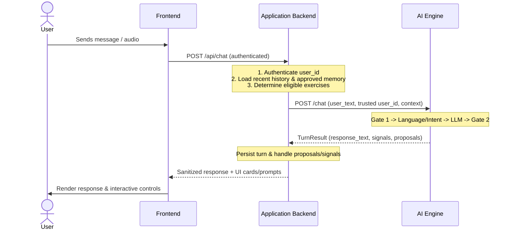
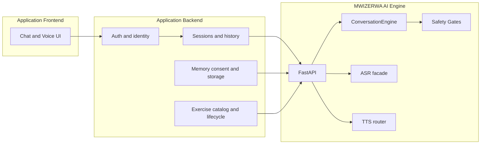

# MWIZERWA AI — Living Integration Guide

**Repository:** [Mindora-AI/ai_engine](https://github.com/Mindora-AI/ai_engine)  
**Document Status:** Living Architecture & Integration Reference  
**Last Updated:** 2026-11-26  

This document serves as the shared architectural and integration reference for **AI Engine**, **Application Backend**, and **Application Frontend** developers working on MWIZERWA. It defines component responsibilities, integration boundaries, API and protocol contracts, and testing strategies.

> [!NOTE]
> **Status Labels Used Throughout This Guide:**
> - **Implemented:** Built, active, and verified in the current repository.
> - **Temporary / Development Only:** Built as an in-memory harness or mock adapter for standalone AI development; must be replaced by the application backend in production.
> - **Proposed:** Target contract or boundary not yet implemented; requires alignment before implementation.
> - **Pending Integration:** AI-side interface exists (e.g., Python `Protocol`), awaiting production backend/frontend wiring.

---

## 1. Current Implementation Status & Outstanding Work

| Area | Current State | Status |
|---|---|---|
| **Core Conversational Inference** | `ConversationEngine` + `AfriqueQwenLLM` + `ConversationManager` (RW/EN/FR) | **Implemented** |
| **Speech Pipeline (ASR & TTS)** | Kinyarwanda Health ASR (`rw`); Whisper Small CPU int8 (`en`/`fr`); KinyaFlex (`rw`, speaker 0) / Pocket TTS (`en`, `fr`) | **Implemented** |
| **Safety Guardrails (Gate 1 & Gate 2)** | Deterministic pre-inference crisis override & post-inference policy validation | **Implemented** |
| **Context & Rolling Summaries** | Token-aware sliding window (`n_ctx=4096`, `max_tokens=768`) + LLM summarization | **Implemented** |
| **Memory Proposal Extraction** | LLM-based extraction of candidate facts (`MemoryProposal`) | **Implemented** |
| **Memory Storage & Consent** | `InMemoryMemoryRepository`, `MockConsentGateway`, `POST /memory/consent` | **Temporary / Development Only** |
| **Production Memory/Consent Adapters** | `MemoryRepository` & `ConsentGateway` protocols awaiting DB-backed implementations | **Pending Integration** |
| **Session & History Persistence** | In-memory `MWIZERWAApiService._sessions` dictionary | **Temporary / Development Only** |
| **Exercise Catalog & Stepping** | Hardcoded `_REGISTRY` (5 exercises) + in-chat text stepping (`ExerciseLifecycle`) | **Implemented** *(Dev fixture / scope to extract)* |
| **Read-Only Exercise API & Interactive Player** | `GET /exercises`, `GET /exercises/{id}` | **Proposed** |
| **Backend-Supplied Turn Context** | `ChatRequest.context` (`approved_memory_summary`, `recent_turns`, `eligible_exercises`) | **Implemented** |
| **`recommended_exercise_id` Response Field** | Top-level on `ChatResponse` / `VoiceResponse` for unsolicited offers | **Implemented** |
| **Structured `safety_signal` Metadata** | Optional object when Gate 1 and/or Gate 2 fire (`PUBLIC_METADATA_KEYS`) | **Implemented** |
| **Backend Crisis Escalation** | Backend escalation policy/logging/notifications | **Proposed** *(AI signals **Implemented**)* |

---

## 2. Agreed Architectural Decisions

The following architectural decisions are **agreed** across the AI Engine, Application Backend, and Application Frontend teams. They resolve earlier boundary ambiguities and govern all upcoming Stage 2 and integration work.

> [!NOTE]
> These decisions define **target ownership and boundaries**; they are not claims that all extractions are already implemented in code.

### A. Channel-Agnostic AI Engine
- The AI engine will remain **channel-agnostic**.
- Initial integration targets the **application backend and frontend**; there is no current plan to support SMS, WhatsApp, or USSD inside the AI engine.
- If additional channels are introduced later, channel-specific formatting or transport handling must live in **application-level adapters**, never inside the AI engine.
- The AI engine exposes consistent, channel-independent capabilities and contracts.

### B. Backend-Owned Exercise Catalog
- The **application backend** owns the authoritative exercise catalog and its definitions.
- The AI engine may retain its existing Python exercise registry (`src/exercises/registry.py`) as a **development and testing fixture**, but it must not become a competing production source of truth.
- In production integration, the backend supplies eligible, verified exercise candidates to the AI engine; the AI engine evaluates suitability and returns recommendations using **stable exercise identifiers/keys**.

### C. Backend-Owned Exercise Lifecycle
- The **application backend** owns authoritative exercise lifecycle state and deterministic business rules, including:
  - Exercise acceptance and rejection.
  - Starting and stopping exercises.
  - Current exercise state and step progression.
  - Completion and abandonment records.
  - Cross-session exercise history.
  - Cooldowns and repetition restrictions.
- The AI engine evaluates exercise suitability and generates conversational guidance, but it must not independently own authoritative application lifecycle state.

### D. Frontend-Owned Exercise Presentation
- The **application frontend** owns the interactive exercise experience, including:
  - Exercise player presentation and recommendation cards.
  - Displaying instructions and individual steps.
  - Visual step navigation (`Next`, `Skip`, `Stop`).
  - Client-side timers and animations (e.g., breathing pacing).
  - Interactive controls and loading, completion, and error states.
- The AI engine must not function as the application's interactive exercise UI.

### E. Backend-Owned Crisis Escalation
- The **AI engine** remains responsible for pre/post-inference safety checks (`Gate 1` and `Gate 2`) and emitting structured safety signals (`gate1_triggered`, `safety_action`, etc.).
- The **application backend** owns all application-level crisis escalation, including:
  - Applying escalation policies.
  - Recording safety incidents.
  - Managing notifications.
  - Counselor assignment and intervention workflows.
- Do not introduce direct webhook or notification responsibilities into the AI inference engine without a concrete future requirement.

### F. Separation of Application Sessions and Conversational Context
State is explicitly divided between **Application Sessions** and **Conversational Inference Context**:
- **Backend responsibilities:**
  - Authenticated user identity.
  - Authoritative application sessions (creation, expiration, persistence, and ownership).
  - Associating application records with authenticated users.
- **AI-engine responsibilities:**
  - Recent conversational turns needed for inference.
  - Rolling conversational summaries.
  - Prompt construction and token budgeting.
  - Other inference-related context and optimizations.
- Moving application session ownership to the backend must **not** remove legitimate AI conversational context management.

### G. Separation of Memory Responsibilities
- **AI-engine responsibilities:** Memory candidate extraction and proposal generation (`MemoryProposal`), plus merging approved items into concise summary text (`merge_approved_into_summary`).
- **Backend responsibilities:**
  - User association and authorization.
  - Consent management and audit records.
  - Pending and approved memory records.
  - Persistent memory storage, updates, and deletion.
  - Supplying approved memory context to subsequent AI requests.
- Temporary in-memory implementations (`InMemoryMemoryRepository`, `MockConsentGateway`) may remain available for isolated development and testing until their backend replacements are implemented and validated.

---

## 3. Component Responsibilities

### A. AI Engine (`ai_engine`)
The AI engine is strictly responsible for **intelligence, inference, and AI-level safety processing**:
- **Multilingual Conversational Understanding & Generation:** Detecting user language (`rw`, `en`, `fr`), handling code-switching, and generating empathetic responses via `AfriqueQwenLLM`. (**Implemented**)
- **Intent Classification & Structured Output:** Producing JSON responses conforming to `ParsedResponse` (`response_text`, `interaction_intent`, `requires_clarification`). (**Implemented**)
- **Inference Context Management:** Managing token budgets, sliding context windows, and generating rolling conversation summaries (`merge_turns_into_summary`). (**Implemented**)
- **Memory Candidate Extraction & Merging:** Identifying factual memory candidates (`MemoryProposal`) from dialogue and merging approved items into concise summaries (`merge_approved_into_summary`). (**Implemented**)
- **Contextual Exercise Suitability Analysis:** Evaluating emotional/somatic cues and conversational intent to recommend an appropriate exercise key. (**Implemented**)
- **Safety Guardrails:** Running pre-inference crisis detection (`Gate 1`) and post-inference output policy checks (`Gate 2`), emitting structured safety signals. (**Implemented**)
- **Speech Processing:** Transcribing audio (`ASREngine`) and routing speech synthesis (`TTSEngine`). (**Implemented**)

> [!IMPORTANT]
> **AI Engine Boundary Rule:** The AI engine must **not** own authoritative user data, enforce application permissions, persist long-term records, or drive frontend step-by-step UI presentation in production.

---

### B. Application Backend (External Service)
The application backend owns **authoritative data, persistence, identity, and deterministic business rules**:
- **User Identity & Authentication:** Authenticating users and supplying trusted `user_id` values to the AI engine (never trusting client-supplied IDs directly). The engine API keeps `user_id` **optional** on `/chat`; authentication is still **mandatory** in the application for memory-backed flows. (**Pending Integration** — engine boundary implemented, backend authority not yet built)
- **Authoritative Session & History Persistence:** Managing session lifecycles, TTLs, and durable storage of conversation turns across devices/restarts. (**Proposed**)
- **Persistent Memory & Consent Authority:** Storing pending memory proposals, capturing explicit user consent decisions, maintaining audit logs, supporting GDPR deletion, and persisting approved memory summaries (`MemoryRepository` & `ConsentGateway` implementations). (**Pending Integration**)
- **Memory Context Supply:** Fetching approved user memory summaries and passing them into AI turn requests. (**Proposed**)
- **Authoritative Exercise Catalog & Lifecycle:** Maintaining the master exercise definitions, providing eligible exercise candidates to the AI engine, enforcing cooldowns, and tracking exercise acceptance, progression, completion, and abandonment history. (**Proposed**)
- **Recommendation Validation:** Validating AI-suggested exercise keys against user eligibility and business rules before exposing actions to the frontend. (**Proposed**)
- **Crisis Escalation & Auditing:** Receiving structured crisis signals from the AI engine and executing organization escalation policies (e.g., logging incidents, alerting human counselors). (**Proposed**)

---

### C. Application Frontend (Web / Mobile Client)
The frontend owns **presentation, user interaction, and visual state**:
- **Conversation Rendering:** Displaying chat messages, loading/error states, language indicators, and playing synthesized TTS audio. (**Proposed**)
- **Interactive Exercise Player:** Rendering exercise recommendation cards (`[Start Exercise]`), fetching exercise definitions, displaying instructions/steps, managing visual step navigation (`[Next]`, `[Skip]`, `[Stop]`), and running client-side timers/animations (e.g., 16-second breath pacing). (**Proposed**)
- **Memory Consent UI:** Presenting memory proposals to the user and sending explicit accept/decline decisions to the backend. (**Proposed**)
- **Safety & Crisis UI States:** Displaying verified crisis helplines and emergency UI banners when instructed by backend/AI safety signals. (**Proposed**)

---

## 4. Responsibility-Extraction Roadmap

Responsibility extraction will proceed **incrementally**. Working implementations in the AI engine must **not** be removed before their replacement integration contract and test coverage are established.

| Priority | Responsibility to Extract | Intended Owner |
|---|---|---|
| **1** | Authoritative application session ownership | **Backend** |
| **2** | Persistent memory storage and consent management | **Backend** |
| **3** | Authoritative exercise catalog management | **Backend** |
| **4** | Exercise lifecycle and cooldown management | **Backend** |
| **5** | Exercise presentation and navigation | **Frontend** |

### Extraction Details

1. **Priority 1 — Authoritative Application Session Ownership (Backend)**
   - **Currently in AI Engine:** `MWIZERWAApiService._sessions` (`src/api/service.py`) stores in-memory `ConversationEngine` instances keyed by `session_id`, alongside full `ConversationManager.messages` history.
   - **Why It Belongs Elsewhere:** User authentication, session expiration/TTL, multi-device continuity, and durable transcript persistence are application backend concerns.
   - **Target Replacement / Boundary:** Backend owns session creation/persistence and supplies recent conversation turns (or rolling summary + tail) to the AI engine per turn.
   - **AI Functionality Retained:** Token budgeting (`n_ctx=4096`), sliding context windowing, prompt construction, and rolling summarization (`merge_turns_into_summary`).
   - **Tests That Must Pass:** `tests/test_token_context_management.py`, `tests/test_rolling_summary.py`, `tests/test_conversation_engine.py`, `tests/test_api.py`.

2. **Priority 2 — Persistent Memory Storage and Consent Management (Backend)**
   - **Currently in AI Engine:** `InMemoryMemoryRepository` (`src/memory/in_memory_repository.py`), `MockConsentGateway` (`src/memory/consent.py`), and dev-only `POST /memory/consent` (`src/api/app.py`).
   - **Why It Belongs Elsewhere:** Consent records, user authorization, encrypted storage, and data erasure belong in the authoritative backend database.
   - **Target Replacement / Boundary:** Backend implements `MemoryRepository` and `ConsentGateway` (or passes `approved_memory_summary` directly on turn requests) and surfaces consent prompts through the frontend.
   - **AI Functionality Retained:** Semantic memory candidate extraction (`extract_memory_proposals`), `merge_approved_into_summary`, and ephemeral prompt injection.
   - **Tests That Must Pass:** `tests/test_persistent_memory.py` (using mock adapters), `tests/test_api.py`.

3. **Priority 3 — Authoritative Exercise Catalog Management (Backend)**
   - **Currently in AI Engine:** Hardcoded static `_REGISTRY` of 5 trilingual exercises in `src/exercises/registry.py`.
   - **Why It Belongs Elsewhere:** Clinical/product teams need to manage, version, and localize exercises in a backend store or CMS without redeploying AI model code.
   - **Target Replacement / Boundary:** Backend exposes the authoritative catalog (`GET /exercises`, `GET /exercises/{id}`) and supplies eligible exercise IDs/metadata to the AI engine; `src/exercises/registry.py` remains only as a dev/test fixture.
   - **AI Functionality Retained:** Contextual suitability evaluation and recommending a stable exercise key from backend-supplied candidates.
   - **Tests That Must Pass:** `tests/test_exercise_domain.py`, `tests/test_exercise_recommender.py`.

4. **Priority 4 — Exercise Lifecycle and Cooldown Management (Backend)**
   - **Currently in AI Engine:** `ExerciseSessionState` (`src/exercises/models.py`) and `ExerciseLifecycle` (`src/exercises/lifecycle.py`) track `OFFERED`/`IN_PROGRESS`/`COMPLETED`/`DECLINED`/`ABANDONED`, `current_step_index`, and `cooldown_turns_remaining`.
   - **Why It Belongs Elsewhere:** Cross-session completion history, repetition limits, and cooldown timers are deterministic application business rules.
   - **Target Replacement / Boundary:** Backend validates AI recommendations against user eligibility/cooldowns and persists lifecycle transitions; AI engine emits `recommended_exercise_id` without mutating authoritative lifecycle state.
   - **AI Functionality Retained:** Emotional/intent suitability analysis (`ExerciseRecommender`) and conversational empathy around exercise suggestions.
   - **Tests That Must Pass:** `tests/test_exercise_recommender.py`, `tests/test_exercise_pipeline_integration.py` (adapted to contract mocks), `tests/test_safety_gates.py`.

5. **Priority 5 — Exercise Presentation and Navigation (Frontend)**
   - **Currently in AI Engine:** `ExerciseLifecycle` formats `"Step 1 of 4: ..."` strings, appends `OFFER_TEMPLATES` into `response_text`, and parses chat keywords (`"next"`, `"komeza"`, `"stop"`).
   - **Why It Belongs Elsewhere:** Rendering cards, step navigation, timers (`duration_seconds`), and animations are UI/presentation concerns.
   - **Target Replacement / Boundary:** Frontend renders an interactive exercise card from structured metadata (`recommended_exercise_id`) and runs a native exercise player using `GET /exercises/{id}`.
   - **AI Functionality Retained:** Clean conversational `response_text` free of injected UI step headers or button prompts.
   - **Tests That Must Pass:** `tests/test_exercise_lifecycle.py` (while dev fallback exists), `tests/test_response_contract.py`, `tests/test_api.py`.

---

## 5. Core Integration Workflows

### 3.1. Conversation Flow
**Current Behavior (Implemented / Temporary):**  
The client calls `POST /chat` or `POST /voice` directly on the AI FastAPI service (`src/api/app.py`). `MWIZERWAApiService` resolves `session_id` in an in-memory dictionary (`_sessions`) and delegates to `ConversationEngine.process_turn()`.

**Target Production Flow (Proposed):**

- **Distinction:** The **Backend** owns the authoritative conversation transcript in its database. The **AI Engine** owns the *inference window* (token-budgeted recent turns + rolling summary).

---

### 3.2. Persistent Memory Flow
The AI engine already exposes protocol boundaries in `src/memory/repository.py` and `src/memory/consent.py`, backed by temporary in-memory mocks for development.

1. **Extraction (Implemented):** After a safe conversational turn, `MemoryCoordinator.propose_from_turn()` extracts candidate facts (`MemoryProposal` with `proposal_id`, `category`, `content`, `confidence`).
2. **Structured Output (Implemented):** Proposals are returned in `TurnResult.metadata["memory_proposals"]` (via `to_public_dict()`).
3. **Consent Registration & UI (Pending Integration / Proposed):** The backend associates proposals with the authenticated `user_id` and surfaces them to the frontend. *(Currently mocked by `MockConsentGateway` and dev-only `POST /memory/consent`.)*
4. **Authorization & Merge (Implemented / Pending Integration):** Upon user acceptance, the backend triggers `merge_approved_into_summary()` (AI capability) and persists the resulting `PersistentMemorySummary` in its database (`MemoryRepository`).
5. **Context Injection (Implemented):** On subsequent turns, the approved summary text is injected ephemerally into the system prompt (`_format_per_turn_system_prompt()`).

> [!WARNING]
> `InMemoryMemoryRepository` and `MockConsentGateway` are **Temporary / Development Only**. They lose all data on restart and must never be used as authoritative production stores.

---

### 3.3. Exercise Recommendations & Execution Flow
**Current Behavior (Implemented — Temporary Scope):**  
`ExerciseRecommender` evaluates deterministic cues/intents and triggers `ExerciseLifecycle.offer_exercise()`, which appends offer phrasing to `response_text`. If accepted in chat, `ConversationEngine` intercepts subsequent turns (`"next"`, `"komeza"`, `"stop"`) and formats `"Step X of Y: ..."` strings.

**Target Production Flow (Proposed):**
1. **Candidate Supply (Proposed):** The backend supplies eligible, verified exercise IDs (accounting for user preferences and cooldowns) to the AI engine.
2. **Suitability Analysis (Implemented / Evolving):** The AI engine evaluates conversational context and recommends a single stable exercise key (e.g., `grounding_54321`) in structured metadata (`recommended_exercise_id`) **without** appending UI copy to `response_text`.
3. **Validation & State (Proposed):** The backend validates the recommendation against business rules and records the offer.
4. **Interactive Execution (Proposed):** The frontend displays an Exercise Card. When the user clicks **Start**, the frontend fetches the definition (`GET /exercises/{id}`) and runs the interactive player (timers, step navigation).
5. **Lifecycle Sync (Proposed):** The frontend reports start, completion, or abandonment events to the backend, which updates user history and cooldowns.

---

### 3.4. Safety & Crisis Escalation Flow
- **AI Engine Role (Implemented):**
  - **Gate 1 (`SafetyEvaluator` + `SafetyGuardrail`):** Runs before LLM inference. If an acute crisis (imminent self-harm, violence, medical emergency) is detected, LLM inference is bypassed, active exercises are aborted, and a verified deterministic response with localized helplines (`112`, `912`, etc.) is returned immediately. Metadata sets `gate1_triggered: true` and `safety_action`.
  - **Gate 2 (`AssistantSafetyValidator`):** Runs after LLM inference to block unsafe model outputs before returning them. Metadata sets `gate2_triggered: true`.
- **Backend Role (Proposed):** Inspects `gate1_triggered` and `safety_action` in the AI response to log safety events, trigger counselor/human escalation workflows, or enforce account-level interventions.
- **Frontend Role (Proposed):** Renders prominent emergency/helpline UI cards when crisis metadata flags are active.

---

## 6. Integration Contracts

For operational details on running and connecting to the FastAPI server (including Colab/ngrok discovery), refer to [DEPLOYMENT_GUIDE.md](DEPLOYMENT_GUIDE.md).

### 6.1. Existing HTTP Contracts (**Implemented**)
Defined in `src/api/app.py`, `src/api/schemas.py`, and `src/api/service.py`.

#### `GET /health`
- **Response (`HealthResponse`):** `{ "status": "ready" | "unavailable", "engine_initialized": bool, "backends": { ... } }`
- `backends` reports dependency importability, cheap artifact checks, and in-process **loaded** flags. Health does **not** load models or download weights.

#### `POST /chat`
- **Request (`ChatRequest`):**
  - `user_text` (`str`, required, non-empty after strip)
  - `session_id` (`Optional[str]`, max 128 chars; omit to create a new session)
  - `mode` (`Optional[Literal["gentle", "normal", "motivational"]]`)
  - `language` (`Optional[str]`, `"rw"` | `"en"` | `"fr"`)
  - `user_id` (`Optional[str]`, max 128 chars — **server-to-server trusted ID only**)
  - `context` (`Optional[TurnContextRequest]`) — trusted backend application context for this turn:
    - `approved_memory_summary` (`Optional[str]`, max 16 000 chars): when **present in JSON**, used as the sole approved-memory input for inference (empty string means no approved memory). When **omitted**, standalone/dev fallbacks apply (`user_id` + in-memory repository if configured).
    - `recent_turns` (`Optional[List[{role, content}]]`, max 40 messages, roles `user`|`assistant`, content max 12 000 chars each): backend-owned recent dialogue. Re-applied only when the fingerprint changes (repeated identical payloads do not duplicate history). Rolling summaries remain AI-owned inside the session engine.
    - `eligible_exercises` (`Optional[List[{id, category}]]`, max 32 items): backend-filtered candidates (`category` is one of `ExerciseCategory` values). When **present as an empty list**, no exercise may be recommended. When **omitted**, the dev Python registry defaults still apply for standalone use.
- **Response (`ChatResponse`):**
  - `session_id` (`str`)
  - `response_text` (`str`)
  - `mode` (`str`)
  - `language` (`Optional[str]`)
  - `recommended_exercise_id` (`Optional[str]`, `null` when no unsolicited offer; stable backend id when an offer was made)
  - `metadata` (`Dict[str, Any]` — filtered by `PUBLIC_METADATA_KEYS`)
- **Exposed `PUBLIC_METADATA_KEYS` (`src/api/service.py`):**
  `interaction_intent`, `requires_clarification`, `detected_language`, `effective_language`, `language_confidence`, `is_language_reliable`, `is_language_mixed`, `safety_action`, `gate1_triggered`, `gate2_triggered`, `exercise_status`, `active_exercise_id`, `current_step_index`, `cooldown_turns_remaining`, `memory_proposals`, `rolling_summary_active`, `safety_signal`.
- **`metadata.safety_signal` (optional object, only when Gate 1 and/or Gate 2 fired):**
  - Always: `gate1_triggered`, `gate2_triggered`, `safety_action`
  - Gate 1 (when triggered): `category`, `subject`, `temporal`, `intent`, `immediacy`, optional `detected_expression_language` — values from existing `SafetyAssessment` enums (`SafetyCategory`, `SubjectTarget`, etc.)
  - Gate 2 (when triggered): optional `gate2_violation_category` from `AssistantSafetyResult.violation_category`
  - Never includes `matched_markers`, regex evidence, or raw assessment objects.
- **Errors:** `400` (`ValueError` / validation / invalid `context`), `503` (model not ready), `500` (internal failure).

**Example `POST /chat` body (production-style server call):**
```json
{
  "user_text": "I feel tense reflecting on today.",
  "session_id": "app-session-uuid",
  "language": "en",
  "context": {
    "approved_memory_summary": "User prefers evening check-ins.",
    "recent_turns": [
      {"role": "user", "content": "Work was stressful."},
      {"role": "assistant", "content": "I hear how heavy that felt."}
    ],
    "eligible_exercises": [
      {"id": "breathing_gentle_rhythm", "category": "breathing"}
    ]
  }
}
```
```json
{
  "session_id": "app-session-uuid",
  "response_text": "...",
  "mode": "normal",
  "language": "en",
  "recommended_exercise_id": "breathing_gentle_rhythm",
  "metadata": {
    "interaction_intent": "reflection",
    "gate1_triggered": false,
    "gate2_triggered": false,
    "safety_action": "normal_conversation",
    "exercise_status": "offered"
  }
}
```

#### `POST /transcribe`, `POST /tts`, `POST /voice`
- `POST /transcribe`: Multipart `audio`, optional `language` (`rw`|`en`|`fr`, default `rw`). Response `{ "transcription", "language" }`. `rw` → Kinyarwanda Health ASR; `en`/`fr` → Whisper Small (`faster-whisper`, optional deps).
- `POST /tts`: Form `text` (`str`), optional `language` (`rw`/`en`/`fr`) -> `audio/wav` binary response.
- `POST /voice`: Multipart `audio` + form `session_id`, `mode`, optional `language` (same ASR routing as `/transcribe`, hint for chat), optional `context_json` -> `VoiceResponse` with `asr_language`, `audio_status`, `audio_error`, and `audio_base64` (nullable on TTS failure after successful chat).

**Trusted identity:** See **§8.3** for the full `user_id` contract (optional on `/chat`, never client-trusted, not available on `/voice`).

#### `POST /memory/consent` (**Temporary / Development Only**)
- **Gate:** Returns `404` unless `MWIZERWA_ALLOW_DEV_MEMORY_CONSENT=1` or `MWIZERWA_ENV` is `development|dev|test|local`.
- **Request (`MemoryConsentRequest`):** `{ "user_id": str, "proposal_id": str, "decision": "accepted" | "declined" }`
- **Response (`MemoryConsentResponse`):** `{ "user_id": str, "proposal_id": str, "applied": bool, "summary_updated": bool, "memory_summary": Optional[str] }`

---

### 6.2. Existing Python Protocol Boundaries (**Pending Integration**)
- **`MemoryRepository` (`src/memory/repository.py`):**
  - `get_summary(user_id: str) -> Optional[PersistentMemorySummary]`
  - `save_summary(record: PersistentMemorySummary) -> None`
  - `update_summary(user_id: str, summary_text: str) -> PersistentMemorySummary`
  - `delete_memory(user_id: str) -> bool`
- **`ConsentGateway` (`src/memory/consent.py`):**
  - `register_pending(user_id: str, proposal: MemoryProposal) -> None`
  - `fetch_pending(user_id: str, proposal_id: str) -> Optional[MemoryProposal]`
  - `finalize(user_id: str, proposal_id: str, decision: ConsentDecision) -> bool`
  - `is_resolved(proposal_id: str) -> bool`

---

### 6.3. Proposed Future Contracts (**Proposed**)

1. **Read-Only Exercise Catalog Endpoints (Backend-Owned Target):**
   - `GET /exercises?lang={rw|en|fr}`: Returns list of available exercises (ID, category, localized name, description, estimated duration).
   - `GET /exercises/{exercise_id}?lang={rw|en|fr}`: Returns full exercise definition including ordered `steps` (`step_number`, `instruction`, `duration_seconds`, `allow_skip`), `cautionary_notes`, and `completion_question`. Returns `404` if not found.

### 6.4. Temporary Standalone Compatibility (**Implemented / Development Only**)

- **In-memory sessions** (`MWIZERWAApiService._sessions`) remain authoritative for dev HTTP clients until the backend owns session persistence.
- **In-memory approved memory** (`InMemoryMemoryRepository` + `user_id`) applies only when `context.approved_memory_summary` is omitted.
- **Python exercise registry** (`CATEGORY_DEFAULT_EXERCISE`, `src/exercises/registry.py`) applies only when `context.eligible_exercises` is omitted. Lifecycle stepping still requires registry definitions for offered IDs during the transition (offer text remains in `response_text`).
- **Recent-turn semantics (Implemented):** `recent_turns` lists backend-persisted `user`/`assistant` pairs only; it must **not** include the current `user_text`. Re-send identical history is ignored (SHA-256 fingerprint). When the fingerprint **changes**, verbatim history is replaced and the **AI rolling summary is cleared** (it is not backend-authoritative). Folding may rebuild from the new tail over subsequent turns.
- **Remaining limitation:** If backend and AI session diverge within the same fingerprint (e.g. silent local commits before a resync), ordering can be briefly inconsistent until the next fingerprint change. Backend should include the latest assistant reply when it is authoritative.

---

## 7. Testing Strategy

As responsibilities migrate to the backend and frontend, the AI engine must remain **independently testable end-to-end**.

| Test Level | Scope & Purpose | Current Coverage & Examples |
|---|---|---|
| **1. Unit Tests** | Test isolated AI modules without external services or real weights where appropriate. | `tests/test_language_detection.py`, `tests/test_safety_evaluator.py`, `tests/test_safety_guardrail.py`, `tests/test_assistant_policy.py`, `tests/test_response_contract.py`, `tests/test_token_context_management.py`, `tests/test_exercise_recommender.py` |
| **2. Contract Tests** | Validate strict JSON schemas (`ParsedResponse`), Pydantic request/response validation, `PUBLIC_METADATA_KEYS` filtering, and error codes (`400`, `404`, `503`). | `tests/test_api.py`, `tests/test_response_contract.py` |
| **3. Mock Integration Tests** | Test `ConversationEngine` and `MemoryCoordinator` using replaceable mock adapters (`InMemoryMemoryRepository`, `MockConsentGateway`, mocked LLM). Keeps dev harnesses separate from production adapters. | `tests/test_conversation_engine.py`, `tests/test_persistent_memory.py`, `tests/test_rolling_summary.py`, `tests/test_exercise_pipeline_integration.py` |
| **4. End-to-End (E2E) Tests** | Exercise full HTTP/turn workflows (`/chat`, `/memory/consent`, `/tts`, `/voice`), safety overrides, and exercise recommendations. Distinguish **mocked-LLM E2E** (fast CI) from **real-inference E2E** (requires AfriqueQwen GGUF, optional faster-whisper, KinyaFlex/Pocket TTS weights). | `tests/test_api.py`, `tests/test_asr_routing.py`, `scripts/colab_validate.py` (real inference) |

**Running Tests:**
```bash
python -m pytest
```
> [!NOTE]
> Always distinguish deterministic mocked-LLM test runs from real-model inference validation. Never report real-model E2E behavior as verified unless executed against loaded weights.

### 7.1. Testing Requirements During Responsibility Extraction

Extracting an application responsibility must **never** break the AI engine's ability to run, reason, and be tested independently. The following rules apply across all extraction phases:

1. **Independent AI Testability:** The AI engine must remain independently testable throughout development without requiring a live production backend or frontend.
2. **Replaceable Interfaces & Adapters:** External backend dependencies (sessions, memory persistence, consent, exercise catalog) must be replaceable via clearly defined interfaces (`Protocol`) or request-level adapters.
3. **Mock Isolation:** Mock implementations (`InMemoryMemoryRepository`, `MockConsentGateway`, static exercise fixture) must support isolated development and automated testing without requiring the production backend.
4. **No Mock Confusion:** Mock implementations must never be mistaken for authoritative production data, consent records, or persistence.
5. **Contract Verification:** Contract tests must verify that the AI engine and its external callers agree on request/response structures, required fields, optional defaults, and error handling.
6. **API-Level E2E Coverage:** End-to-end tests must exercise complete AI workflows through the HTTP/service API using mock backend dependencies where necessary.
7. **Mock vs. Real-Model Separation:** Real-model inference validation must be explicitly distinguished from deterministic mock/model tests.
8. **Strict Verification Reporting:** No real-model or production integration validation may be reported as successful unless it has actually been executed.

**Required E2E / Integration Test Scenarios:**
- **Supplied Approved Memory Context:** Sending a conversation turn with backend-supplied `approved_memory_summary` and verifying the AI uses it appropriately without inventing unapproved facts.
- **Memory Proposal & Simulated Consent:** Generating `MemoryProposal` items from a turn, applying a simulated backend consent decision, and verifying summary merging.
- **Exercise Recommendation from Verified Candidates:** Supplying eligible verified exercise keys from a mock backend and verifying the AI recommends a valid key without mutating backend lifecycle state.
- **Structured Safety Signal & Backend Handling:** Triggering Gate 1 / Gate 2 and verifying structured safety metadata (`gate1_triggered`, `safety_action`) is emitted cleanly for backend escalation handling.
- **Session Continuity Without AI Session Authority:** Maintaining multi-turn inference continuity (recent turns + rolling summary) when session creation, ownership, and persistence live outside the AI engine.

---

## 8. Backend integration handbook

This section is the **primary handoff** for application backend developers. Canonical request/response shapes live in `src/api/schemas.py`; HTTP wiring in `src/api/app.py`. Operational runbook: [DEPLOYMENT_GUIDE.md](DEPLOYMENT_GUIDE.md). Endpoint reference: [docs/API.md](docs/API.md).

### 8.1. System architecture



**AI engine:** inference, safety signals, speech conversion, recommendation *selection* among supplied candidates, memory *proposals*.  
**Backend:** authentication, durable sessions, approved memory, consent, exercise catalog/eligibility/lifecycle, crisis escalation policy.  
**Frontend:** rendering, exercise player, consent UI, crisis banners.

### 8.2. Deployment and connectivity

```bash
pip install -r requirements-api.txt
# Optional EN/FR ASR: pip install -r requirements-asr-whisper.txt
python scripts/serve_api.py
```

| Variable | Purpose |
|----------|---------|
| `MWIZERWA_API_HOST` / `MWIZERWA_API_PORT` | Bind address (default `127.0.0.1:8000`) |
| `MWIZERWA_MODELS_DIR` | GGUF, KinyaFlex checkpoints |
| `MWIZERWA_POCKET_FR_VOICE` | French Pocket TTS voice (default `estelle`) |
| `MWIZERWA_LLM_N_GPU_LAYERS` | LLM GPU offload (default `0` CPU) |
| `MWIZERWA_MAX_UPLOAD_BYTES` | Audio upload cap (default 25 MiB) |
| `MWIZERWA_WHISPER_MODEL` | Default `small` for EN/FR ASR |
| `MWIZERWA_ENV` / `MWIZERWA_ALLOW_DEV_MEMORY_CONSENT` | Enable dev `POST /memory/consent` only in non-prod |

**Health:** `GET /health` returns `engine_initialized` (LLM loaded at startup) and `backends` readiness without loading ASR/TTS weights. Use before routing user traffic.

**Artifacts:** AfriqueQwen Q4_K_M GGUF under `models/afriqueqwen/`; EN/FR Whisper Small and Pocket TTS weights via Hugging Face cache after first use; KinyaFlex under `models/kinya-flex-tts/`.

### 8.3. Authentication and trusted identity

The engine supports **standalone** operation (CLI, local API demos) and **backend-integrated** operation. These modes share the same HTTP contracts; what changes is who supplies trusted context.

#### User identity contract (`POST /chat`)

| Rule | Behavior |
|------|----------|
| **Optional field** | `user_id` is **not required**. Requests without it support ordinary conversation with no user-associated persistent memory proposals tied to a trusted store (dev in-memory hooks may still be disabled). |
| **When present** | Must be a **valid, non-empty** identifier after trim (max 128 chars). Empty or whitespace → **422**. |
| **No authentication in engine** | The engine does **not** authenticate users and does **not** decide whether an id is trustworthy. |
| **Backend responsibility** | Authenticate the user, resolve the **authoritative** internal user id, and send it only on **server-to-server** calls to the engine. |
| **Never trust the client** | Do **not** forward a raw `user_id` from an unauthenticated browser or mobile client. |
| **Application auth** | Optional `user_id` on the engine API does **not** make authentication optional in the product. Any flow that uses memory proposals, consent, or user-specific approved memory **must** be gated by backend authentication. |
| **Do not make `user_id` mandatory** | Do not require `user_id` on the engine API solely to force backend discipline—enforce identity in the backend instead. |

When `user_id` is set, the engine may return `metadata.memory_proposals` for backend consent handling. Approved memory for inference should be supplied via `context.approved_memory_summary` from the backend’s durable store (see §8.7).

#### Voice and identity (`POST /voice`)

| Fact | Detail |
|------|--------|
| **Not implemented** | `/voice` does **not** accept `user_id` (multipart fields: `audio`, `session_id`, `mode`, `language`, `context_json` only). |
| **Implication** | A voice turn cannot trigger the same trusted memory-proposal path as a `/chat` call with `user_id` in a single request. Session-scoped dialogue still advances via `session_id`. |
| **Current integration pattern** | (A) Use `/voice` for modality only and accept no per-user memory proposals on that path; or (B) call `POST /transcribe`, then `POST /chat` with the transcript, trusted `user_id`, and full `context` (and optionally `POST /tts` for reply audio). |
| **Future** | A `user_id` (or equivalent) on `/voice` is a possible contract extension—**not** shipped today. Do not assume voice memory support without backend-supplied `approved_memory_summary` in `context_json`. |

#### Development-only identity and memory

`InMemoryMemoryRepository`, `MockConsentGateway`, and `POST /memory/consent` simulate consent for local testing. They are **non-authoritative** and unsuitable for production persistence.

### 8.4. Text conversation (`POST /chat`)

See **Section 6.1** for schema. Backend should always send `context` in production when memory or exercise eligibility matters.

**Languages:** optional `language` hint `rw` | `en` | `fr` (422 if invalid).

**Sessions:** `session_id` omitted → new UUID. Same id → same in-process `ConversationEngine` (lost on process restart; not multi-worker safe).

### 8.5. Voice (`POST /voice`, `/transcribe`, `/tts`)

| Endpoint | Role |
|----------|------|
| `/transcribe` | ASR only; optional `language` (`rw` default) |
| `/tts` | Synthesis only; returns `audio/wav` bytes |
| `/voice` | ASR → chat → TTS JSON |

**ASR routing:** `rw` → Kinyarwanda Health ASR; `en`/`fr` → Whisper Small. Missing `faster-whisper` → **503** for EN/FR.

**Partial TTS success:** HTTP **200** with `audio_status: "failed"`, `audio_base64: null`, safe `audio_error`, preserved `transcription` and `response_text`. **Do not retry** the whole voice request—conversation already advanced.

**`/voice` context:** optional `context_json` string matching `TurnContextRequest` (same semantics as `POST /chat` `context`).

### 8.6. Conversation context

| Field | Omitted | Empty | Set |
|-------|---------|-------|-----|
| `approved_memory_summary` | Dev fallbacks via `user_id` if present | No approved memory | Use exact string |
| `recent_turns` | AI session history only | N/A (use `[]` if needed) | Replace verbatim tail; max 40 turns |
| `eligible_exercises` | Dev registry fallback | **No** recommendations allowed | Only listed ids |

Limits: memory 16 000 chars; turn content 12 000 chars each; ≤32 exercises; purpose_summary ≤500 chars. Validation errors → **400**.

### 8.7. Memory integration

1. Engine returns `metadata.memory_proposals` (when enabled).
2. Backend stores pending proposals linked to **trusted** `user_id`.
3. User consents via **backend** UI (not client-only).
4. Backend persists approved summary.
5. Backend sends `context.approved_memory_summary` on subsequent turns.

Proposals **never** auto-persist. Dev `POST /memory/consent` mirrors step 3–4 for local testing only.

### 8.8. Wellness recommendations

- Supply `eligible_exercises: [{id, category, purpose_summary?}]` from your catalog.
- Empty list **suppresses** unsolicited offers (no dev registry fallback).
- Response: `recommended_exercise_id` must be one of supplied ids when present.
- Backend validates eligibility, cooldowns, and lifecycle before frontend display.
- In-chat exercise stepping remains a **dev** behavior when lifecycle is engine-owned.

### 8.9. Errors, retries, and recovery

| Situation | Guidance |
|-----------|----------|
| **503** health `unavailable` | Wait for LLM load; do not hammer |
| **400** validation | Fix payload; no retry |
| **500** chat failure | Generic message; safe to retry **same** user text only if idempotent policy allows |
| **Voice TTS failed, 200** | Show text; optional `/tts` retry; **do not** re-POST `/voice` with same audio |
| **413** upload | Reduce size |
| Process restart | New `session_id` or resync `recent_turns` + `approved_memory_summary` |

Serialization: `_inference_lock` and `_asr_lock` serialize heavy work in a **single worker**. Multiple uvicorn workers ⇒ **duplicate session maps** unless backend owns session affinity or always supplies `recent_turns`.

### 8.10. Security and privacy

- TLS between backend and engine in production.
- Do not log raw audio or full approved memory in shared logs.
- Strip PII from client→backend before forwarding.
- Disable dev memory consent endpoint in production (`MWIZERWA_ENV` not `development`).
- Crisis: consume `metadata.safety_signal` / `gate1_triggered`; escalate per org policy.

### 8.11. Backend integration acceptance checklist

| Check | Mocked tests | Requires backend |
|-------|--------------|------------------|
| Text chat + session id | `tests/test_api.py` | E2E with real auth |
| Voice partial TTS failure | `tests/test_api.py` | Client UX |
| EN/FR ASR language form | `tests/test_api.py` | Natural speech corpus |
| Empty `eligible_exercises` blocks offers | `tests/test_exercise_recommender.py` | Catalog sync |
| Approved memory via context | `tests/test_persistent_memory.py` | DB persistence |
| Safety Gate 1 crisis path | `tests/test_safety_gates.py` | Escalation workflow |
| Health backends without load | `tests/test_api.py` | Load balancer wiring |

**Real inference evidence (not pytest):** `benchmarks/asr_en_fr/results_whisper_small.json`, `results_coreidency.json`.

### 8.12. Known limitations (honest status)

- **Natural EN/FR ASR:** not validated on licensed conversational corpus (Common Voice fetch pending Hub auth). Synthetic TTS benchmarks (legacy Piper clips in manifest; regeneration uses Pocket TTS).
- **Co-residency:** sequential LLM + Whisper measured locally (~4.5 GB peak RSS); **not** concurrent inference; not a production capacity sign-off.
- **Backend:** no built-in authentication, durable sessions, or authoritative memory DB.
- **Full app E2E:** requires backend + frontend not yet built.
- **Multi-worker:** in-memory sessions are per process.

---

## 9. Remaining Implementation-Level Ambiguities

While high-level architectural ownership is resolved in **Section 2 (Agreed Architectural Decisions)**, the following implementation-level details remain **Proposed** and require schema/API design before coding:

1. **Backend session persistence vs. AI rolling summary sync:** How to reconcile backend-owned transcripts with AI-owned rolling summaries on partial history replays.
2. **Exercise lifecycle extraction:** When the frontend player owns stepping, how `ExerciseLifecycle` in-chat stepping is retired without breaking existing behavioral tests.

---

## 10. Living Document Maintenance Rules

This guide is a **mandatory engineering artifact** and must remain understandable to backend and frontend developers who have not participated in the AI engine's internal development. All contributors must update this document in the same PR/stage whenever:

1. **Responsibility Extraction:** Any responsibility is transferred between the AI engine, backend, and frontend (e.g., migrating session ownership, removing `MockConsentGateway`, or retiring in-chat exercise stepping).
2. **New Integration Contracts:** Any new backend or frontend integration contract, HTTP endpoint, or `Protocol` boundary is introduced.
3. **Schema Changes:** Any AI-engine request structure, response structure, or `PUBLIC_METADATA_KEYS` entry is added, renamed, or removed.
4. **Temporary Implementation Replacement:** Any temporary/development implementation is replaced, deprecated, or removed — its status in **Section 1** must be updated immediately.
5. **Adapter Changes:** Any new mock adapter or production adapter is introduced or updated.
6. **Pre-Implementation Boundary Review:** Responsibility boundaries in **Sections 2 & 3** must be reviewed before implementing new cross-component features.
7. **Test & Mock Evolution:** Tests and mock adapters documented in **Section 7** must evolve alongside the contracts they validate.
