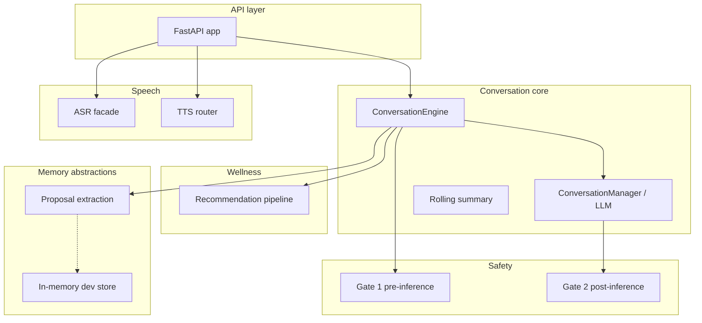

# MWIZERWA AI — Isolated inference engine

**Repositories:** [Mindora-AI/ai_engine](https://github.com/Mindora-AI/ai_engine) · [blessed-winner/MWIZERWA](https://github.com/blessed-winner/MWIZERWA)

MWIZERWA AI is an offline-capable, multilingual conversational companion (Kinyarwanda, English, French) with safety guardrails, wellness exercise recommendation intelligence, speech recognition, text-to-speech, and a FastAPI integration surface. It is designed to run **standalone** for development and to be called by a **future application backend** that owns authentication, durable sessions, and persistent user data.

> [!IMPORTANT]
> MWIZERWA is a **supportive companion**, not a therapist or medical provider. Gate 1 provides deterministic crisis redirection. Clinical escalation policy belongs to the application backend.

**Project status:** The isolated AI engine has completed its **integration-readiness milestone** and awaits application-backend integration. Durable auth, production memory, and full product E2E are **not** implemented in this repository.

---

## 1. Project overview

| | |
|---|---|
| **Purpose** | Attentive multilingual dialogue, safety evaluation, optional memory *proposals*, and exercise *selection* among backend-supplied candidates |
| **Languages** | `rw` (Kinyarwanda), `en` (English), `fr` (French) |
| **Primary entry points** | CLI (`run_assistant.py`, `launch_menu.py`), HTTP API (`scripts/serve_api.py`) |

---

## 2. Capabilities

| Capability | In this repo | Requires application backend |
|------------|:------------:|:------------------------------:|
| Multilingual text conversation | ✓ | Session durability across devices |
| Voice pipeline (ASR → chat → TTS) | ✓ | Trusted `user_id` on voice paths |
| Safety Gate 1 / Gate 2 | ✓ | Crisis escalation workflow |
| Wellness recommendation selection | ✓ (from supplied candidates) | Exercise catalog, eligibility, lifecycle |
| Memory *proposals* | ✓ (with trusted `user_id` on `/chat`) | Consent UI, persistence, GDPR |
| Approved memory in context | ✓ (`context.approved_memory_summary`) | Authoritative memory store |
| Authentication | — | ✓ |

**ASR:** Kinyarwanda → Kinyarwanda Health ASR (`rw`); English/French → **Whisper Small** via optional `faster-whisper`.  
**TTS:** Kinyarwanda → KinyaFlex; English/French → Piper.

---

## 3. Architecture



| Layer | Responsibility |
|-------|----------------|
| **API** (`src/api/`) | HTTP contracts, uploads, health, context mapping |
| **Conversation engine** | Turn orchestration, session state, backend context merge |
| **LLM** (`src/llm/`) | AfriqueQwen GGUF via `llama-cpp-python`, parsing, prompts |
| **Safety** (`src/safety/`) | Crisis detection and output policy |
| **Recommendations** (`src/exercises/`) | Suitability among **eligible** candidates; dev registry when omitted |
| **ASR** (`src/asr/`) | Language routing (`rw` / `en` / `fr`) |
| **TTS** (`src/tts/`) | KinyaFlex + Piper routing |
| **Memory** (`src/memory/`) | Proposals and dev consent; **not** production persistence |

---

## 4. Repository structure

```text
├── src/                    # Application source (api, conversation, llm, safety, exercises, asr, tts, memory)
├── tests/                  # Automated tests (mocked; no GGUF required)
├── tests/behavioral/       # Multi-turn behavioral regressions
├── scripts/                # serve_api.py, download_models.py, benchmarks, Colab helpers
├── benchmarks/             # ASR benchmark results and methodology (asr_en_fr/)
├── docs/                   # INSTALLATION, API, ARCHITECTURE, TESTING, …
├── config/                 # model_registry.json
├── notebooks/              # Colab notebook
├── INTEGRATION_GUIDE.md    # Backend integration handbook (§8 primary handoff)
├── DEPLOYMENT_GUIDE.md     # Colab/ngrok and connectivity
├── requirements.txt        # Core runtime (LLM, Kinya ASR, TTS stack)
├── requirements-api.txt    # FastAPI server
├── requirements-asr-whisper.txt   # Optional EN/FR ASR
├── requirements-dev.txt    # pytest + httpx for tests
└── setup_env.bat / .sh     # Bootstrap .venv and core deps
```

Model weights live under `models/` (gitignored). Use `scripts/download_models.py`.

---

## 5. Requirements and installation

**Python:** 3.10, 3.11, or 3.12 (as used by `setup_env.bat` / `setup_env.sh`).

### Core installation

**Windows (PowerShell):**

```powershell
git clone https://github.com/Mindora-AI/ai_engine.git
cd ai_engine
.\setup_env.bat
.\.venv\Scripts\activate
python scripts/download_models.py
pip install -r requirements-api.txt
pip install -r requirements-dev.txt
```

**Linux / macOS:**

```bash
git clone https://github.com/Mindora-AI/ai_engine.git
cd ai_engine
chmod +x setup_env.sh && ./setup_env.sh
source .venv/bin/activate
python scripts/download_models.py
pip install -r requirements-api.txt
pip install -r requirements-dev.txt
```

Detailed steps (DeepKIN/KinyaFlex, troubleshooting): [docs/INSTALLATION.md](docs/INSTALLATION.md).

### Optional English/French ASR

Kinyarwanda ASR uses **transformers** (core `requirements.txt`). English/French use **faster-whisper** (separate install):

```powershell
.\.venv\Scripts\activate
pip install -r requirements-asr-whisper.txt
```

| Variable | Default | Meaning |
|----------|---------|---------|
| `MWIZERWA_WHISPER_MODEL` | `small` | Hugging Face faster-whisper size |
| `MWIZERWA_WHISPER_DEVICE` | `cpu` | Device |
| `MWIZERWA_WHISPER_COMPUTE_TYPE` | `int8` | CTranslate2 compute type |

First EN/FR transcribe downloads weights into the Hugging Face cache. Verify with `GET /health` → `backends.asr_whisper` (see [docs/API.md](docs/API.md)).

---

## 6. Configuration

| Variable | Purpose |
|----------|---------|
| `MWIZERWA_API_HOST` / `MWIZERWA_API_PORT` | API bind (default `127.0.0.1:8000`) |
| `MWIZERWA_MODELS_DIR` | Root for GGUF, Piper, KinyaFlex artifacts |
| `MWIZERWA_LLM_N_GPU_LAYERS` | GPU layers for llama.cpp (`0` = CPU) |
| `MWIZERWA_MAX_UPLOAD_BYTES` | Max audio upload (default 25 MiB) |
| `MWIZERWA_WHISPER_*` | Optional EN/FR ASR (above) |
| `MWIZERWA_ENV` / `MWIZERWA_ALLOW_DEV_MEMORY_CONSENT` | Dev-only memory consent endpoint |

Paths and registry: `config/model_registry.json`, [docs/MODELS_AND_AUDIO.md](docs/MODELS_AND_AUDIO.md).

---

## 7. Running the API

```powershell
.\.venv\Scripts\activate
python scripts/serve_api.py
```

**Health check:**

```powershell
curl http://127.0.0.1:8000/health
```

Expect `status: "ready"` and `engine_initialized: true` after the GGUF loads. OpenAPI: `http://127.0.0.1:8000/docs`.

**CLI (no HTTP):** `python launch_menu.py` or `python run_assistant.py --mode text`.

---

## 8. API documentation

| Document | Use |
|----------|-----|
| [docs/TEST_GUIDE.md](docs/TEST_GUIDE.md) | **Manual API testing** (terminal, Swagger, every endpoint) |
| [docs/API.md](docs/API.md) | Endpoint reference |
| [INTEGRATION_GUIDE.md](INTEGRATION_GUIDE.md) §8 | Backend handoff (identity, context, memory, voice, errors) |
| [docs/MEMORY.md](docs/MEMORY.md) | Memory proposal dev flow |
| [DEPLOYMENT_GUIDE.md](DEPLOYMENT_GUIDE.md) | Colab, ngrok, endpoint registry |

Canonical JSON schemas: `src/api/schemas.py`.

---

## 9. Testing

**Mocked suite (no model weights):**

```powershell
.\.venv\Scripts\activate
pytest tests/ -q
```

**Distinction:**

| Type | Location | Needs GGUF / GPU |
|------|----------|------------------|
| Unit / API / contract tests | `tests/` | No |
| Behavioral regressions | `tests/behavioral/` | No |
| ASR benchmarks | `scripts/benchmark_whisper_asr.py` | Whisper + clips |
| Co-residency benchmark | `scripts/benchmark_coreidency_llm_whisper.py` | LLM + Whisper |
| Live LLM probes | `scripts/validate_token_context_real_model.py` | Yes |

See [docs/TESTING.md](docs/TESTING.md).

---

## 10. Benchmarks

| Asset | Description |
|-------|-------------|
| [benchmarks/asr_en_fr/README.md](benchmarks/asr_en_fr/README.md) | Synthetic EN/FR ASR methodology |
| [benchmarks/asr_en_fr/results_whisper_small.json](benchmarks/asr_en_fr/results_whisper_small.json) | Whisper Small results |
| [benchmarks/asr_en_fr/results_coreidency.json](benchmarks/asr_en_fr/results_coreidency.json) | Sequential LLM + Whisper RSS/latency |
| [benchmarks/asr_en_fr/NATURAL_CORPUS.md](benchmarks/asr_en_fr/NATURAL_CORPUS.md) | Planned natural-speech validation |

Regenerate clips: `scripts/prepare_asr_benchmark_clips.py` (local synthetic WAV; not committed — `*.wav` gitignored).

---

## 11. Current limitations

- Natural **English/French conversational** ASR accuracy is **not** validated on a representative licensed corpus (synthetic Piper clips only).
- Co-residency results are **sequential**, environment-specific, and **not** a production capacity guarantee.
- API **sessions are in-memory** per process; multi-worker deployments need backend-supplied `recent_turns` or affinity.
- **Authentication**, authoritative identity, durable sessions, and production memory **belong to the application backend**.
- `/voice` does **not** accept `user_id`; see INTEGRATION_GUIDE §8.3.
- Full **application E2E** requires backend and frontend not in this repo.

---

## 12. Further documentation

- [docs/INSTALLATION.md](docs/INSTALLATION.md) · [docs/RUNNING.md](docs/RUNNING.md) · [docs/ARCHITECTURE.md](docs/ARCHITECTURE.md)
- [docs/TROUBLESHOOTING.md](docs/TROUBLESHOOTING.md) · [docs/COLAB.md](docs/COLAB.md)
- [docs/DEVELOPER_HANDOVER.md](docs/DEVELOPER_HANDOVER.md) — internal engineering invariants