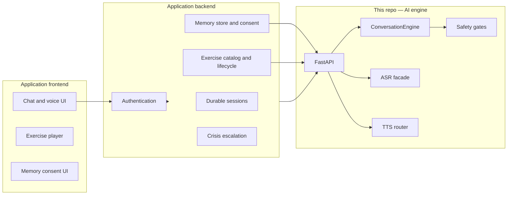
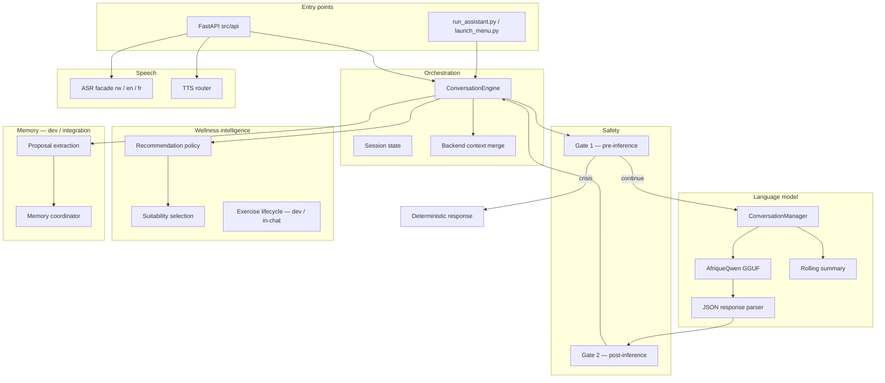

# MWIZERWA AI

**Multilingual supportive conversational inference engine** — Kinyarwanda, English, and French.

| Mirror repositories |
|---------------------|
| [Mindora-AI/ai_engine](https://github.com/Mindora-AI/ai_engine) |
| [blessed-winner/MWIZERWA](https://github.com/blessed-winner/MWIZERWA) |

---

## Table of contents

1. [Introduction](#1-introduction)
2. [What MWIZERWA is and is not](#2-what-mwizerwa-is-and-is-not)
3. [Who this repository is for](#3-who-this-repository-is-for)
4. [Languages and modality support](#4-languages-and-modality-support)
5. [Three-layer product architecture](#5-three-layer-product-architecture)
6. [Inference engine architecture](#6-inference-engine-architecture)
7. [Technology stack](#7-technology-stack)
8. [HTTP API surface](#8-http-api-surface)
9. [Capability matrix](#9-capability-matrix)
10. [Repository layout](#10-repository-layout)
11. [Source code (`src/`)](#11-source-code-src)
12. [Scripts (`scripts/`)](#12-scripts-scripts)
13. [Tests (`tests/`)](#13-tests-tests)
14. [Documentation index](#14-documentation-index)
15. [Dependency bundles](#15-dependency-bundles)
16. [Installation](#16-installation)
17. [Configuration](#17-configuration)
18. [Running the engine](#18-running-the-engine)
19. [Verification and testing](#19-verification-and-testing)
20. [Benchmarks and performance evidence](#20-benchmarks-and-performance-evidence)
21. [Project status and known limitations](#21-project-status-and-known-limitations)
22. [Further reading](#22-further-reading)

---

## 1. Introduction

**MWIZERWA AI** is an offline-capable **inference engine** for attentive, multilingual dialogue. It combines a local large language model (AfriqueQwen), deterministic safety guardrails, wellness exercise *recommendation intelligence*, optional memory *proposals*, and a full speech stack (recognition and synthesis).

The engine is built to run in two modes:

- **Standalone** — developers use the CLI or local FastAPI server for demos, research, and regression testing.
- **Backend-integrated** — a future **application backend** authenticates users, persists data, and calls this engine over HTTP with trusted context.

This repository contains **only the AI engine**. It does not ship a production web or mobile app, user authentication, or durable user databases.

**Current milestone:** integration readiness for the isolated engine is complete. Application-backend and full product end-to-end work are **out of scope here**.

---

## 2. What MWIZERWA is and is not

| MWIZERWA **is** | MWIZERWA **is not** |
|-----------------|---------------------|
| A supportive conversational companion | A therapist, psychiatrist, doctor, or crisis hotline operator |
| A channel-agnostic inference service | The interactive exercise UI (timers, step buttons, cards) |
| A source of safety *signals* (Gate 1 / Gate 2) | The owner of clinical escalation policy or incident response |
| A selector among **backend-supplied** exercise candidates | The authoritative exercise catalog or lifecycle store in production |
| A proposer of memory *candidates* when given a trusted `user_id` | The system of record for consent, GDPR, or approved memory |

When Gate 1 detects imminent crisis language, the engine returns **deterministic** localized emergency guidance and bypasses normal LLM generation. Escalation workflows belong to the application backend.

---

## 3. Who this repository is for

| Reader | Start here |
|--------|------------|
| **New engineer** (no prior context) | This README → [docs/INSTALLATION.md](docs/INSTALLATION.md) → [docs/TEST_GUIDE.md](docs/TEST_GUIDE.md) |
| **Backend integrator** | [INTEGRATION_GUIDE.md](INTEGRATION_GUIDE.md) **§8** (handbook) + [docs/API.md](docs/API.md) |
| **ML / speech engineer** | [docs/MODELS_AND_AUDIO.md](docs/MODELS_AND_AUDIO.md) + `config/model_registry.json` |
| **Maintainer extending core logic** | [docs/ARCHITECTURE.md](docs/ARCHITECTURE.md) + [docs/DEVELOPER_HANDOVER.md](docs/DEVELOPER_HANDOVER.md) |
| **Colab operator** | [docs/COLAB.md](docs/COLAB.md) + `notebooks/MWIZERWA_Colab.ipynb` |

---

## 4. Languages and modality support

| Code | Language | Text chat | Kinyarwanda ASR | Whisper ASR (optional) | TTS engine | Safety overrides |
|------|----------|:---------:|:---------------:|:----------------------:|:----------:|:----------------:|
| `rw` | Kinyarwanda | ✓ | ✓ (default) | — | KinyaFlex (speaker 0) | ✓ |
| `en` | English | ✓ | — | ✓ (`small`, CPU int8) | Pocket TTS (`anna`) | ✓ |
| `fr` | French | ✓ | — | ✓ (`small`, CPU int8) | Pocket TTS (`estelle`) |

Per-turn language detection runs inside the conversation pipeline. Optional `language` on HTTP requests is a **hint**, not a substitute for detection.

**ASR routing:** `rw` → ElvisTata **Kinyarwanda Health ASR** (Hugging Face `transformers`, in core deps). `en` / `fr` → **faster-whisper** Small (separate install: `requirements-asr-whisper.txt`).

**TTS routing:** response text language drives synthesis — KinyaFlex for `rw`, Pocket TTS for `en` and `fr`.

---

## 5. Three-layer product architecture

The full MWIZERWA product is intentionally split across three responsibilities. Only the **center column** lives in this repository.



**Rules that survive integration:**

- Never treat a client-supplied `user_id` as authenticated identity; the backend resolves identity and calls the engine server-to-server.
- `user_id` on `POST /chat` remains **optional** at the engine boundary; authentication is still mandatory in the product for memory-backed flows.
- `/voice` does **not** accept `user_id` today (see [INTEGRATION_GUIDE.md](INTEGRATION_GUIDE.md) §8.3).

---

## 6. Inference engine architecture

### 6.1 Logical components



### 6.2 Single text turn (conceptual order)

1. **Validate** `TurnRequest` (or HTTP `ChatRequest` mapped to a turn).
2. **Merge** optional backend `context` (approved memory, recent turns, eligible exercises).
3. **Detect** language for the user message.
4. **Gate 1** — if crisis patterns match, abort exercises, skip LLM, return emergency copy.
5. **Exercise lifecycle** — if a dev in-chat exercise is active or offered, handle deterministic stepping before LLM where applicable.
6. **Build prompt** — system prompt, language directive, mode, token-budgeted history (`n_ctx=4096`, generation budget configured in LLM layer).
7. **LLM inference** — AfriqueQwen must return strict JSON: `response_text`, `interaction_intent`, `requires_clarification`.
8. **Gate 2** — validate assistant text; replace with safe fallback if policy fails.
9. **Recommendations** — if backend supplied candidates, select among them; empty list suppresses offers; dev registry applies only when context omits candidates (standalone).
10. **Memory proposals** — optional extraction when trusted `user_id` is present on `/chat`.
11. **Commit** history only after successful validation (ConversationManager owns the sole message list).
12. **Return** `TurnResult` / HTTP `ChatResponse` with public metadata and optional `recommended_exercise_id`.

Voice turns (`POST /voice`) run **ASR → same chat path → TTS** with partial-success semantics if TTS fails after chat succeeds.

### 6.3 Engineering invariants

These are expanded in [docs/DEVELOPER_HANDOVER.md](docs/DEVELOPER_HANDOVER.md) and [docs/ARCHITECTURE.md](docs/ARCHITECTURE.md):

- `ConversationManager.messages` is the **only** authoritative conversation history inside the engine.
- Gate 1 always runs before LLM or exercise progression on normal paths.
- Gate 2 always runs before assistant text is committed.
- Exercise **steps** in the dev registry are pre-authored trilingual content, not LLM-generated.
- Application session durability and cross-device history are **backend** concerns; the API keeps in-memory `session_id` maps per process.

---

## 7. Technology stack

| Subsystem | Technology | Notes |
|-----------|------------|--------|
| LLM | AfriqueQwen3.5-4B-Instruct Q4_K_M GGUF (~2.86 GB) | `llama-cpp-python`; GPU optional via `MWIZERWA_LLM_N_GPU_LAYERS` |
| Kinyarwanda ASR | `ElvisTata2024/Kinyarwanda-Health-ASR` | `transformers` pipeline |
| EN/FR ASR | faster-whisper **Small** | Optional; CPU `int8` default |
| Kinyarwanda TTS | KinyaFlex (FlexKinyaTTS via DeepKIN-AgAI) | PyTorch checkpoint; editable install from `ac-ai-models/` |
| EN/FR TTS | Kyutai Pocket TTS | `pocket-tts` |
| HTTP API | FastAPI + Uvicorn | `requirements-api.txt` |
| Tests | pytest + httpx TestClient | Mocked; no weights required for CI-style runs |

Model download URLs, checksums, and paths: **`config/model_registry.json`** and **`scripts/download_models.py`**.

---

## 8. HTTP API surface

**Canonical schemas:** `src/api/schemas.py` · **OpenAPI:** `{base}/docs` when the server is running.

| Method | Path | Purpose |
|--------|------|---------|
| `GET` | `/health` | LLM readiness + cheap `backends` report (does not load ASR/TTS on its own) |
| `POST` | `/chat` | JSON text conversation + optional `context` and optional trusted `user_id` |
| `POST` | `/tts` | Form → `audio/wav` |
| `POST` | `/transcribe` | Multipart audio → JSON transcription |
| `POST` | `/voice` | Multipart audio → ASR + chat + base64 WAV reply |
| `POST` | `/memory/consent` | **Development only** — simulates consent after memory proposals |

**Default bind:** `127.0.0.1:8000` (`MWIZERWA_API_HOST`, `MWIZERWA_API_PORT`).

**Manual testing:** step-by-step terminal and Swagger instructions in [docs/TEST_GUIDE.md](docs/TEST_GUIDE.md).

**Backend integration:** [INTEGRATION_GUIDE.md](INTEGRATION_GUIDE.md) §8.

---

## 9. Capability matrix

| Capability | Implemented in this repo | Requires application backend / frontend |
|------------|:--------------------------:|:---------------------------------------:|
| Multilingual text dialogue | ✓ | Durable sessions across devices |
| Voice pipeline (ASR → chat → TTS) | ✓ | Trusted identity on voice-first memory flows |
| Gate 1 / Gate 2 safety | ✓ | Escalation, logging, human handoff |
| Exercise recommendation *selection* | ✓ (from supplied IDs) | Catalog, eligibility, cooldowns, player |
| In-chat exercise stepping | ✓ (dev fixture) | Authoritative lifecycle in production |
| Memory *proposals* on `/chat` | ✓ with `user_id` | Consent UI, persistence, deletion |
| Approved memory at inference | ✓ via `context.approved_memory_summary` | Database of record |
| User authentication | — | ✓ |
| Product E2E | — | ✓ |

---

## 10. Repository layout

Top-level map of **tracked, intentional** project artifacts. Large binaries (`models/`, `*.gguf`, local `outputs/`, virtual environments) are **gitignored**.

```text
MWIZERWA / ai_engine/
│
├── src/                          # All runtime Python application code
├── tests/                        # Automated regression and contract tests
├── tests/behavioral/               # Multi-turn behavioral regression tests
├── scripts/                        # CLI utilities, API server, downloads, benchmarks, Colab
├── docs/                           # Human-readable guides (installation, API, testing, …)
├── benchmarks/                     # Recorded benchmark results and methodology
├── config/                         # model_registry.json — authoritative asset metadata
├── deployment/                     # Optional public endpoint registry (ngrok pointer JSON)
├── notebooks/                      # Google Colab notebook
├── ac-ai-models/                   # DeepKIN-AgAI (KinyaFlex); submodule / clone target (gitignored when absent)
│
├── INTEGRATION_GUIDE.md            # Living architecture + backend handbook (§8)
├── DEPLOYMENT_GUIDE.md             # Colab, ngrok, connectivity patterns
├── README.md                       # This file
│
├── run_assistant.py                # CLI: text, text-voice, voice modes
├── launch_menu.py                  # Interactive launcher for CLI modes
├── setup_env.bat / setup_env.sh      # Create .venv and install core requirements
│
├── requirements.txt                # Core stack (torch, llama-cpp, transformers, TTS, …)
├── requirements-api.txt            # FastAPI server
├── requirements-asr-whisper.txt    # Optional EN/FR ASR
├── requirements-dev.txt            # pytest + httpx
├── requirements-colab.txt          # Colab entry → packages file (no torch pin)
├── requirements-colab-packages.txt # Colab-compatible pins
└── constraints-colab.txt           # Pip constraints for Colab installs
```

**Generated locally (not in Git):** `.venv/`, `models/`, `outputs/`, `*.wav`, `__pycache__/`, Hugging Face caches.

---

## 11. Source code (`src/`)

Each package below is production engine code unless noted as dev-only.

### `src/api/` — HTTP integration layer

| Module | Role |
|--------|------|
| `app.py` | FastAPI routes, lifespan (LLM load at startup), upload handling |
| `schemas.py` | **Public contract** — request/response Pydantic models |
| `service.py` | Session map, chat/voice orchestration, public metadata filter |
| `context_mapping.py` | Maps API `context` → internal `TurnContext` |
| `readiness.py` | Builds `GET /health` `backends` object without heavy loads |
| `audio_utils.py` | Temp upload files, size limits |

### `src/conversation/` — Turn orchestration

| Module | Role |
|--------|------|
| `engine.py` | **ConversationEngine** — safety, exercises, LLM delegate, recommendations, memory hooks |
| `session.py` | `TurnRequest`, `TurnResult`, modes, session-facing types |
| `context_integration.py` | Validates and applies backend turn context |
| `safety_signal.py` | Structured safety metadata for API responses |
| `compat.py` | Small helpers bridging CLI and engine construction |

### `src/llm/` — Model and dialogue state

| Module | Role |
|--------|------|
| `conversation.py` | **ConversationManager** — sole owner of `messages`, prompt build, generation |
| `afrique_qwen.py` | GGUF load and inference via llama-cpp |
| `response_parser.py` | Strict JSON contract enforcement |
| `response_cleaner.py` | Normalizes raw model output before parse |
| `prompts.py` | System and per-turn prompt templates |
| `rolling_summary.py` | LLM-assisted rolling summary for long threads |
| `chat.py` | Lower-level chat helpers |

### `src/safety/` — Guardrails

| Module | Role |
|--------|------|
| `evaluator.py` | Gate 1 pattern evaluation |
| `guardrail.py` | Crisis override orchestration |
| `assistant_policy.py` | Gate 2 output policy |
| `crisis_responses.py` | Localized deterministic crisis copy |
| `categories.py`, `resources.py` | Taxonomy and resource metadata |

### `src/exercises/` — Wellness content and recommendations

| Module | Role |
|--------|------|
| `registry.py` | **Dev fixture** — five trilingual static exercises |
| `recommender.py` | Orchestrates recommendation vs explicit requests |
| `recommendation_policy.py` | When unsolicited offers are allowed |
| `suitability_selection.py` | Picks among backend `eligible_exercises` |
| `lifecycle.py` | In-chat stepping state machine (dev scope) |
| `categories.py`, `models.py` | Exercise taxonomy and data models |

### `src/memory/` — Proposals and dev persistence

| Module | Role |
|--------|------|
| `extraction.py` | LLM-based memory candidate extraction |
| `coordinator.py` | Proposals + consent application flow |
| `consent.py` | Consent gateway protocol + mock |
| `repository.py` | Memory repository protocol |
| `in_memory_repository.py` | **Dev-only** in-process store |
| `dev_consent.py` | Env gate for `POST /memory/consent` |
| `types.py`, `prompts.py`, `summary_merge.py` | Types and merge logic |

### `src/asr/` — Speech recognition

| Module | Role |
|--------|------|
| `asr_engine.py` | Facade and `resolve_asr_language()` routing |
| `kinya_health_asr.py` | Kinyarwanda Health ASR backend |
| `whisper_asr.py` | faster-whisper backend for `en` / `fr` |
| `exceptions.py` | Missing Whisper, unsupported language |

### `src/tts/` — Speech synthesis

| Module | Role |
|--------|------|
| `tts_engine.py` | High-level synthesize API |
| `tts_router.py` | Language → KinyaFlex vs Pocket TTS |
| `kinya_flex_engine.py` | KinyaFlex inference (speaker 0) |
| `pocket_tts_engine.py` | Pocket TTS inference |

### `src/runtime/` — Paths

| Module | Role |
|--------|------|
| `model_paths.py` | Resolves `MWIZERWA_MODELS_DIR` and registry paths |

### `src/utils/`

| Module | Role |
|--------|------|
| `language_detector.py` | Per-turn `rw` / `en` / `fr` detection |

---

## 12. Scripts (`scripts/`)

| Script | Purpose |
|--------|---------|
| `serve_api.py` | **Start FastAPI** — loads GGUF once at startup |
| `download_models.py` | Download / verify assets from `model_registry.json` |
| `colab_runtime.py` | Colab: Drive paths, deps, llama-cpp, DeepKIN install helpers |
| `colab_validate.py` | Colab real-inference validation gate |
| `colab_gradio.py` | Optional Gradio UI after validation |
| `benchmark_whisper_asr.py` | EN/FR ASR benchmark runner |
| `benchmark_coreidency_llm_whisper.py` | Sequential LLM + Whisper RSS/latency study |
| `coreidency_worker.py` | Worker subprocess for co-residency benchmark |
| `prepare_asr_benchmark_clips.py` | Generate local synthetic benchmark WAVs |
| `prepare_natural_cv_clips.py` | Prepare natural-speech corpus (when HF access allows) |
| `benchmark_runtime.py`, `benchmark_cpu_threads.py` | LLM runtime characterization |
| `validate_token_context_real_model.py` | Live GGUF token-budget probe |
| `test_asr.py`, `test_kinya_flex.py` | Manual ASR / TTS smoke scripts |
| `verify_notebook_imports.py` | Notebook import sanity check |

---

## 13. Tests (`tests/`)

The test suite is **large and automated**; individual files are not listed here by design.

| Area | Location | What it protects |
|------|----------|------------------|
| Unit and integration tests | `tests/test_*.py` | API contracts, safety, exercises, memory mocks, ASR routing, parsing, token context |
| Behavioral regressions | `tests/behavioral/` | Multi-turn intent fidelity, safety boundaries, multilingual behavior |

**Run (no model weights required):**

```powershell
.\.venv\Scripts\activate
pytest tests/ -q
```

Expect on the order of **400+** passing tests with mocks. Details: [docs/TESTING.md](docs/TESTING.md).

---

## 14. Documentation index

| Document | Audience | Contents |
|----------|----------|----------|
| **README.md** (this file) | Everyone | Orientation, architecture, repo map |
| [INTEGRATION_GUIDE.md](INTEGRATION_GUIDE.md) | Backend / frontend leads | Boundaries, contracts, handbook §8 |
| [docs/API.md](docs/API.md) | Integrators | Endpoint reference |
| [docs/TEST_GUIDE.md](docs/TEST_GUIDE.md) | QA / developers | Manual test every endpoint |
| [docs/INSTALLATION.md](docs/INSTALLATION.md) | New developers | OS-specific setup, DeepKIN |
| [docs/RUNNING.md](docs/RUNNING.md) | Operators | CLI modes and workflows |
| [docs/ARCHITECTURE.md](docs/ARCHITECTURE.md) | Maintainers | Formal pipeline and state machines |
| [docs/MODELS_AND_AUDIO.md](docs/MODELS_AND_AUDIO.md) | ML engineers | Weights, audio stack |
| [docs/MEMORY.md](docs/MEMORY.md) | Integrators | Memory proposal dev flow |
| [docs/TESTING.md](docs/TESTING.md) | CI / QA | Test inventory philosophy |
| [docs/TROUBLESHOOTING.md](docs/TROUBLESHOOTING.md) | Everyone | Common failures |
| [docs/COLAB.md](docs/COLAB.md) | Colab operators | Drive layout, notebook order |
| [docs/COLAB_AUDIT.md](docs/COLAB_AUDIT.md) | Maintainers | Notebook audit notes |
| [DEPLOYMENT_GUIDE.md](DEPLOYMENT_GUIDE.md) | Remote integrators | ngrok, endpoint registry |
| [docs/DEVELOPER_HANDOVER.md](docs/DEVELOPER_HANDOVER.md) | Core engineers | Invariants when changing code |

---

## 15. Dependency bundles

| File | Install when |
|------|----------------|
| `requirements.txt` | Always (core engine, Kinya ASR deps, TTS stack) |
| `requirements-api.txt` | Running `scripts/serve_api.py` |
| `requirements-asr-whisper.txt` | EN/FR speech recognition |
| `requirements-dev.txt` | Running `pytest` |
| `requirements-colab.txt` / `requirements-colab-packages.txt` | Google Colab notebook path |

On Windows, if `llama-cpp-python` fails to compile, use a prebuilt wheel (documented in [docs/INSTALLATION.md](docs/INSTALLATION.md)).

---

## 16. Installation

**Supported Python:** 3.10, 3.11, or 3.12.

### Windows (PowerShell)

```powershell
git clone https://github.com/Mindora-AI/ai_engine.git
cd ai_engine
.\setup_env.bat
.\.venv\Scripts\activate
python scripts/download_models.py --check
python scripts/download_models.py
pip install -r requirements-api.txt
pip install -r requirements-dev.txt
```

### Linux / macOS

```bash
git clone https://github.com/Mindora-AI/ai_engine.git
cd ai_engine
chmod +x setup_env.sh && ./setup_env.sh
source .venv/bin/activate
python scripts/download_models.py
pip install -r requirements-api.txt
pip install -r requirements-dev.txt
```

### Optional English/French ASR

```powershell
pip install -r requirements-asr-whisper.txt
```

First use downloads Whisper Small into the Hugging Face cache.

---

## 17. Configuration

| Variable | Default | Meaning |
|----------|---------|---------|
| `MWIZERWA_MODELS_DIR` | `models/` under project root | GGUF, KinyaFlex paths |
| `MWIZERWA_POCKET_FR_VOICE` | `estelle` | Optional French Pocket voice override |
| `MWIZERWA_PROJECT_ROOT` | Auto from checkout | Colab / custom layouts |
| `MWIZERWA_API_HOST` | `127.0.0.1` | API bind address |
| `MWIZERWA_API_PORT` | `8000` | API port |
| `MWIZERWA_LLM_N_GPU_LAYERS` | `0` | llama.cpp GPU layers (`0` = CPU) |
| `MWIZERWA_MAX_UPLOAD_BYTES` | 25 MiB | Max audio upload |
| `MWIZERWA_WHISPER_MODEL` | `small` | faster-whisper model id |
| `MWIZERWA_WHISPER_DEVICE` | `cpu` | Whisper device |
| `MWIZERWA_WHISPER_COMPUTE_TYPE` | `int8` | CTranslate2 compute type |
| `MWIZERWA_ENV` | unset | Set `development` to enable dev `POST /memory/consent` |
| `MWIZERWA_ALLOW_DEV_MEMORY_CONSENT` | unset | `1` / `true` forces consent endpoint on |

Registry and artifact layout: **`config/model_registry.json`**.

---

## 18. Running the engine

### HTTP API (recommended for integration work)

```powershell
.\.venv\Scripts\activate
$env:MWIZERWA_ENV = "development"   # optional: dev memory consent
python scripts/serve_api.py
```

Wait until the GGUF finishes loading, then:

```powershell
curl -s http://127.0.0.1:8000/health
```

- **Swagger UI:** http://127.0.0.1:8000/docs  
- **Manual test script:** [docs/TEST_GUIDE.md](docs/TEST_GUIDE.md)

### CLI (no HTTP)

```powershell
python launch_menu.py
```

or

```powershell
python run_assistant.py --mode text
python run_assistant.py --mode text-voice
python run_assistant.py --mode voice --audio-file path\to\user.wav
```

See [docs/RUNNING.md](docs/RUNNING.md).

### Google Colab

Open `notebooks/MWIZERWA_Colab.ipynb`, GPU runtime, follow [docs/COLAB.md](docs/COLAB.md). Step **10** starts the API in the background and runs smoke tests.

---

## 19. Verification and testing

| Goal | Command / doc |
|------|----------------|
| Fast automated regression | `pytest tests/ -q` |
| API contract smoke (mocked) | `pytest tests/test_api.py -q` |
| Every endpoint live | [docs/TEST_GUIDE.md](docs/TEST_GUIDE.md) + running server |
| Live LLM probe | `python scripts/validate_token_context_real_model.py` |

**Do not** confuse mocked pytest success with production speech quality or capacity — live ASR/TTS/LLM need weights and time.

---

## 20. Benchmarks and performance evidence

| Path | What it documents |
|------|-------------------|
| [benchmarks/asr_en_fr/README.md](benchmarks/asr_en_fr/README.md) | Synthetic EN/FR ASR methodology |
| [benchmarks/asr_en_fr/results_whisper_small.json](benchmarks/asr_en_fr/results_whisper_small.json) | Whisper Small runs |
| [benchmarks/asr_en_fr/results_coreidency.json](benchmarks/asr_en_fr/results_coreidency.json) | **Sequential** LLM + Whisper memory sample |
| [benchmarks/asr_en_fr/NATURAL_CORPUS.md](benchmarks/asr_en_fr/NATURAL_CORPUS.md) | Planned licensed natural-speech validation |

Benchmark WAV clips are generated locally (`prepare_asr_benchmark_clips.py`); audio files are gitignored.

---

## 21. Project status and known limitations

**Status:** The **isolated AI engine** has reached **integration readiness**. The **application backend** (authentication, durable sessions, production memory, exercise lifecycle, crisis operations) and **frontend** are **not** in this repository.

**Limitations to read before production claims:**

- Natural **conversational** EN/FR ASR is **not** signed off on a representative licensed corpus (synthetic clips only today).
- Co-residency numbers are **sequential**, machine-specific, and **not** a production capacity guarantee.
- API **sessions are in-memory** per process; use backend-supplied `recent_turns` or sticky routing for multiple workers.
- `/voice` has **no** `user_id`; memory-aware voice requires transcribe → `/chat` or future contract extension.
- `POST /memory/consent` and in-memory memory stores are **development fixtures**.
- Full product E2E requires backend + frontend.

---

## 22. Further reading

- **Backend handoff:** [INTEGRATION_GUIDE.md](INTEGRATION_GUIDE.md) §8  
- **Endpoint walkthrough:** [docs/TEST_GUIDE.md](docs/TEST_GUIDE.md)  
- **Deep pipeline spec:** [docs/ARCHITECTURE.md](docs/ARCHITECTURE.md)

---

*MWIZERWA AI — supportive companion technology. Not a substitute for professional mental health or emergency services.*