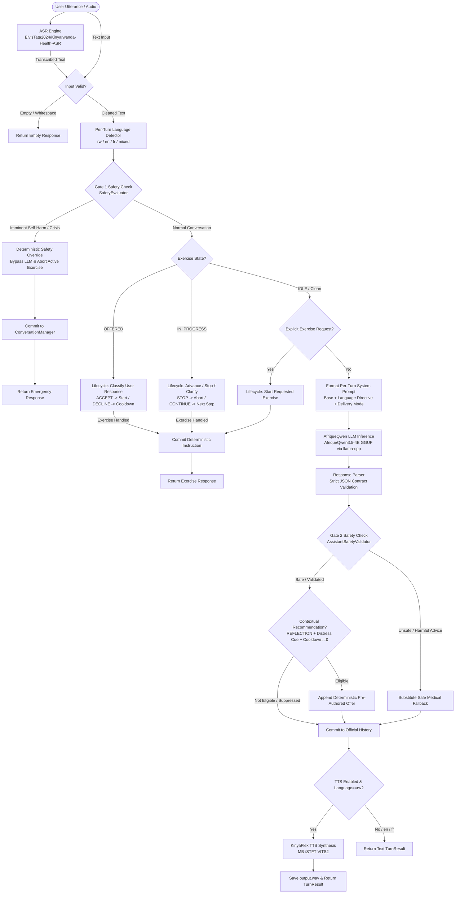

# MWIZERWA AI — System Architecture Specification

This document provides the formal architectural specification of MWIZERWA AI, detailing subsystem boundaries, data flow contracts, safety gates, and state machines.

---

## 1. High-Level Architectural Diagram



---

## 2. Component Specifications

### 2.1 ConversationEngine (`src/conversation/engine.py`)
`ConversationEngine` is the top-level orchestrator. It holds no duplicate history; all history is owned strictly by `ConversationManager`.
- **Responsibilities:**
  - Validates incoming `TurnRequest`.
  - Coordinates per-turn `LanguageDetector`.
  - Enforces **Gate 1** pre-inference safety interception.
  - Routes exercise state transitions (OFFERED, IN_PROGRESS, IDLE).
  - Delegates response generation to `ConversationManager`.
  - Evaluates contextual recommendations after inference.
  - Constructs predictable, typed `TurnResult` metadata.

### 2.2 ConversationManager (`src/llm/conversation.py`)
`ConversationManager` is the **sole owner of conversation history** (`self.messages`).
- **Token-Aware Context Budgeting:**
  - Reserve formula: `budget = n_ctx - max_tokens - safety_margin` (`4096 - 512 - 16 = 3568 tokens`).
  - Pre-inference verification: if prompt exceeds budget, oldest complete turn pairs (`user`, `assistant`) are evicted from candidate history while index 0 (`system`) is permanently preserved.
  - If a user turn alone exceeds the budget, `OversizedMessageError` is raised without mutating state.
- **Atomic State Commits:**
  - Conversation history is mutated **only upon successful generation and Gate 2 validation**.
  - Deterministic turns (safety overrides or exercise steps) are committed via `record_deterministic_turn()`.

### 2.3 Structured Response Contract (`src/llm/response_parser.py`)
AfriqueQwen is constrained to output exclusively a single raw JSON object conforming to this schema:
```json
{
  "response_text": "Assistant's actual speakable response.",
  "interaction_intent": "LISTENING",
  "requires_clarification": false
}
```
- **`interaction_intent` Constraints:** Exactly one of:
  - `LISTENING`: User primarily seeks to express a burden and feel heard. Unsolicited exercises and advice are strictly suppressed.
  - `REFLECTION`: User explores thoughts and experiences. Eligible for contextual exercise offers only if somatic/cognitive distress cues exist.
  - `PRACTICAL_ADVICE`: User explicitly seeks suggestions. Exercise offers are suppressed.
  - `UNCLEAR`: Intent is ambiguous; assistant gently clarifies. Exercise offers are suppressed.
- **`requires_clarification` Constraints:** Boolean. When `true`, contextual recommendations are suppressed on that turn and carried forward to guide the next turn.

### 2.4 Safety Subsystem (Two-Tier Guardrails)

#### Gate 1: Pre-Inference Emergency Overrides (`src/safety/evaluator.py`, `src/safety/guardrail.py`)
- Independent deterministic pattern matcher executed **before** model generation or exercise processing.
- Detects imminent self-harm, active suicide preparation, and severe acute crisis across Kinyarwanda, English, and French.
- **Behavior on Trigger:**
  1. Aborts any active exercise immediately (`ExerciseStatus.IDLE`).
  2. Completely bypasses LLM inference.
  3. Returns localized crisis helpline instructions (e.g. 112, emergency services, trusted contact).
  4. Records the deterministic turn in conversation history.

#### Gate 2: Post-Inference Assistant Safety Validation (`src/safety/assistant_policy.py`)
- Independent validator that reviews the model's generated `response_text` before it is committed to history or presented to the user.
- Scans for:
  - Encouragement or instruction in self-harm, suicide, or violence.
  - Dangerous chemicals, poisons, or lethal methods.
  - Unauthorized clinical diagnosis or prescription of medication.
- **Behavior on Trigger:**
  1. Discards the unsafe model output.
  2. Substitutes an approved safe emergency medical fallback.
  3. Commits only the approved safe response to history.

### 2.5 Exercise Recommendation & Lifecycle Subsystem (`src/exercises/`)
- **Static Catalog (`registry.py`):** Verified, offline trilingual steps for:
  1. `breathing_gentle_rhythm` (Gentle Rhythmic Breathing, 4 steps)
  2. `grounding_54321` (5-4-3-2-1 Sensory Grounding, 5 steps)
  3. `reflection_gentle_perspective` (Gentle Perspective Reflection, 3 steps)
  4. `compassion_pause` (Self-Compassion Pause, 3 steps)
  5. `gratitude_grounded_anchor` (Grounded Anchor Gratitude, 3 steps)
- **Recommender (`recommender.py`):**
  - Explicit requests: Recognized immediately, bypassing cooldown.
  - Unsolicited recommendations: Evaluated only during `REFLECTION` intent when cooldown is 0 and specific distress cues are matched.
- **Lifecycle Manager (`lifecycle.py`):**
  - Manages step index and instruction delivery.
  - Classifies user control words:
    - Continuation: `next`, `continue`, `proceed`, `komeza`, `suivant`.
    - Stop/Abort: `stop`, `cancel`, `hagarika`, `arrête` (halts exercise, applies 5-turn cooldown).
    - Hesitation: `hold on`, `wait`, `give me a moment`, `mpa akanya`, `attendez` (yields gentle clarification without advancing step).

### 2.6 Audio Pipeline (ASR & TTS)
- **ASR Engine (`src/asr/asr_engine.py`):** Wraps `ElvisTata2024/Kinyarwanda-Health-ASR` with HuggingFace pipeline. Converts input audio to transcribed text.
- **TTS Engine (`src/tts/tts_engine.py`):** Wraps `FlexKinyaTTS` (MB-iSTFT-VITS2). Synthesizes Kinyarwanda text into 24kHz 16-bit Mono PCM audio. Safely skips synthesis for English or French text.
